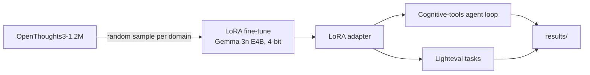

<div align="center">

# Gemma 3n Critical Thinker

**LoRA reasoning fine-tune of Gemma 3n with a cognitive-tools agent loop**

[](https://github.com/Premchand006/gemma-3n-critical-thinker/actions/workflows/ci.yml)
[](LICENSE)
[](pyproject.toml)
[](https://huggingface.co/anhsirk/gemma-3n-critical-thinker)
[](https://colab.research.google.com/github/Premchand006/gemma-3n-critical-thinker/blob/main/notebooks/01_finetune_gemma3n_colab.ipynb)

</div>

**Gemma 3n Critical Thinker** fine-tunes Google's **Gemma 3n E4B** for step-by-step reasoning with a 4-bit **LoRA** adapter (Unsloth + TRL) trained on **OpenThoughts3-1.2M**. It includes an open-source Python implementation of the **cognitive-tools agent loop** from Ebouky et al. (2025) and **Lighteval** scripts to benchmark the result on math, science and reasoning tasks.

Everything runs on a free Google Colab T4 GPU. This is a student minor project from Amrita Vishwa Vidyapeetham, Coimbatore.

> [!NOTE]
> **Status.** One short training run has been completed and its adapter is published as [`anhsirk/gemma-3n-critical-thinker`](https://huggingface.co/anhsirk/gemma-3n-critical-thinker). The evaluation code is ready but has not yet been run on a GPU, so **no benchmark scores are reported**. See [Results](#results).

## Contents

- [Features](#features)
- [How it works](#how-it-works)
- [Quick start](#quick-start)
- [Usage](#usage)
- [Training run](#training-run)
- [Results](#results)
- [Project layout](#project-layout)
- [Limitations](#limitations)
- [Documentation](#documentation)
- [Citation](#citation)
- [License](#license)

## Features

| Component | What it does | Code |
| --- | --- | --- |
| **Data** | Streams OpenThoughts3-1.2M and draws a random sample per domain (math, code, science) with exact quotas | [`data.py`](src/cogtools/data.py) |
| **Training** | 4-bit LoRA fine-tune of `gemma-3n-E4B-it` with Unsloth and TRL; loss on the assistant turns only | [`train.py`](src/cogtools/train.py) |
| **Cognitive tools** | The model calls four helper prompts on itself (`understand_question`, `recall_related`, `examine_answer`, `backtracking`) before answering | [`tools/`](src/cogtools/tools/) |
| **Agent evaluation** | Runs the tool loop over a JSONL file of math problems and checks the final answers | [`agent_eval.py`](src/cogtools/eval/agent_eval.py) |
| **Benchmarks** | Scores the base model plus adapter on 13 Lighteval tasks | [`lighteval_runner.py`](src/cogtools/eval/lighteval_runner.py) |

## How it works



In the agent loop, the model writes a tool call, the same model answers that tool's prompt in a fresh context, and the result returns as an `Observation:` turn. The loop ends when the model writes `ANSWER:`. Details are in [docs/method.md](docs/method.md).

## Quick start

The tests run on any machine with Python 3.10 or newer. No GPU is needed.

```bash
git clone https://github.com/Premchand006/gemma-3n-critical-thinker.git
cd gemma-3n-critical-thinker
pip install -e ".[dev]"
pytest
```

### Run on Google Colab

| Notebook | Open |
| --- | --- |
| Fine-tune Gemma 3n | [](https://colab.research.google.com/github/Premchand006/gemma-3n-critical-thinker/blob/main/notebooks/01_finetune_gemma3n_colab.ipynb) |
| Cognitive-tools demo | [](https://colab.research.google.com/github/Premchand006/gemma-3n-critical-thinker/blob/main/notebooks/02_cognitive_tools_demo.ipynb) |
| Lighteval scoring | [](https://colab.research.google.com/github/Premchand006/gemma-3n-critical-thinker/blob/main/notebooks/03_evaluate_lighteval_colab.ipynb) |

Choose a **T4 GPU** runtime and store your Hugging Face token as a Colab secret named `HF_TOKEN`. Never paste a token into a cell.

## Usage

Training and evaluation use different pinned package sets, so install them in separate environments.

**Training** (Colab T4 or another CUDA GPU)

```bash
pip install -r requirements/train.txt && pip install -e . --no-deps
python scripts/prepare_data.py --config configs/train_gemma3n_e4b.yaml --out data/subset.jsonl
python scripts/train.py --config configs/train_gemma3n_e4b.yaml
```

**Cognitive-tools agent**

```bash
python scripts/solve.py --question "What is 17 * 23?"          # one question
python scripts/agent_eval.py --data data/sample_math.jsonl     # a problem file
python scripts/agent_eval.py --data data/sample_math.jsonl --tools ""   # no-tools baseline
```

**Benchmark scoring** (separate environment)

```bash
pip install -r requirements/eval.txt && pip install -e . --no-deps
python scripts/evaluate.py --config configs/eval_tasks.yaml --max-samples 100
python scripts/summarize_results.py results/<timestamp>/results.json
```

To reproduce the October 2025 run, use `configs/train_gemma3n_e4b_original.yaml` with `requirements/train-original.txt`. `configs/train_gemma3n_e4b.yaml` holds the recommended settings for a new run, which has not been run yet.

## Training run

| Setting | Value |
| --- | --- |
| Base model | `unsloth/gemma-3n-E4B-it`, loaded in 4-bit |
| LoRA | r = 8, alpha = 8, dropout 0, language layers only |
| Data collected | 2,497 rows of OpenThoughts3-1.2M (math 1,770 · code 520 · science 207) |
| Data trained on | 240 rows (60 steps, batch 1, gradient accumulation 4) |
| Sequence length | 1,024 tokens |
| Optimizer | AdamW 8-bit, learning rate 2e-4, linear schedule, 5 warmup steps |
| Hardware and time | One Tesla T4, 632 seconds |

This run was small. Most OpenThoughts3 answers are tens of thousands of characters long, so at 1,024 tokens almost every example was cut off before its reasoning ended. The sample was also the first rows of each domain rather than a random draw. [docs/training.md](docs/training.md) has the full record and the fixes made since.

## Results

**No scores have been measured yet.** Earlier drafts of this project reported benchmark numbers that no run produced. They have been removed, and [docs/history.md](docs/history.md) explains why.

To produce real numbers, run `scripts/evaluate.py` and `scripts/agent_eval.py`, then commit the JSON from `results/` together with the table from `scripts/summarize_results.py`. [docs/evaluation.md](docs/evaluation.md) lists the tasks and settings.

## Project layout

```text
configs/         training and evaluation settings (YAML)
data/            sample_math.jsonl, a few problems for smoke tests
docs/            method, training record, evaluation, model card, history
notebooks/       thin Colab notebooks that call the package
requirements/    pinned package sets for training, evaluation and development
scripts/         command-line entry points
src/cogtools/    the Python package
tests/           CPU-only tests (pytest)
results/         evaluation output (git-ignored except for committed summaries)
```

## Limitations

- Gemma 3n E4B has about 8B raw parameters and a memory footprint close to a 4B model.
- Lighteval 0.11 has no HumanEval or MBPP task, so code ability is not scored.
- The tool prompts come from a paper that tested them on math only. Whether they help a 4B-effective model has not been measured.
- `use_code` runs model-written Python in a child process with a timeout. That is not a security sandbox, so it is off by default.

## Documentation

| Document | Contents |
| --- | --- |
| [docs/method.md](docs/method.md) | How the cognitive-tools loop works |
| [docs/training.md](docs/training.md) | The training record and changes since |
| [docs/evaluation.md](docs/evaluation.md) | Benchmark tasks and agent evaluation |
| [docs/model_card.md](docs/model_card.md) | Model card for the Hugging Face adapter |
| [docs/history.md](docs/history.md) | What changed from the original project files |
| [CONTRIBUTING.md](CONTRIBUTING.md) | How to set up, test and send changes |

## Citation

If you use this code, cite it with the metadata in [CITATION.cff](CITATION.cff) (GitHub shows a **Cite this repository** button). Please also cite:

- B. Ebouky, A. Bartezzaghi, M. Rigotti. *Eliciting Reasoning in Language Models with Cognitive Tools.* arXiv:2506.12115, 2025.
- E. Guha et al. *OpenThoughts: Data Recipes for Reasoning Models.* arXiv:2506.04178, 2025.

## Authors

Sri Krishna V · Tarun Patnana · L K M Prem Chand Korukonda, Amrita Vishwa Vidyapeetham, Coimbatore.

## License

The code is under the [Apache License 2.0](LICENSE). The tool prompts are adapted from a CC BY 4.0 paper ([NOTICE](NOTICE)). Gemma 3n weights, and adapters trained on them, fall under the [Gemma Terms of Use](https://ai.google.dev/gemma/terms). OpenThoughts3-1.2M is released under Apache 2.0.
